# Catching wind turbine drivetrain faults early

Wind Turbine Failure Detection | AIML Project 1 (Low-Code)

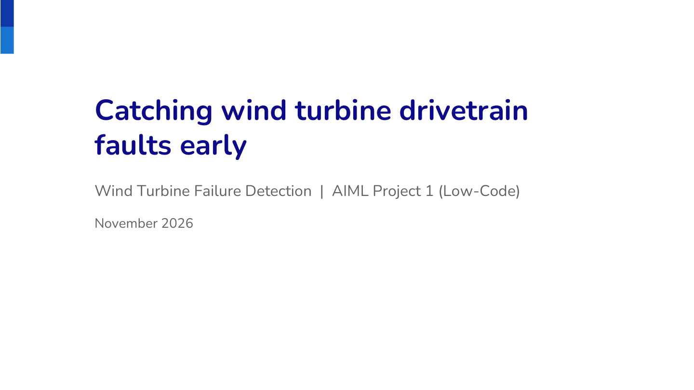

This README follows the same order as the presentation, and each section shows the slide with its graphs. The full deck is in [presentation/](presentation/Wind_Turbine_Failure_Detection_Presentation.pdf) as a PDF and a PPTX.

## Contents

1. Executive Summary
2. Business Problem Overview and Solution Approach
3. EDA Results
4. Data Preprocessing
5. Model Performance Summary and Final Model Selection
6. Actionable Insights and Recommendations
7. Appendix

## Executive Summary

Only 3% of the 131,760 readings are faults, and the final model catches 76% of them on data it has never seen (1,101 of 1,440). During a fault the drivetrain shakes about twice as hard, which makes vibration the clearest warning sign.

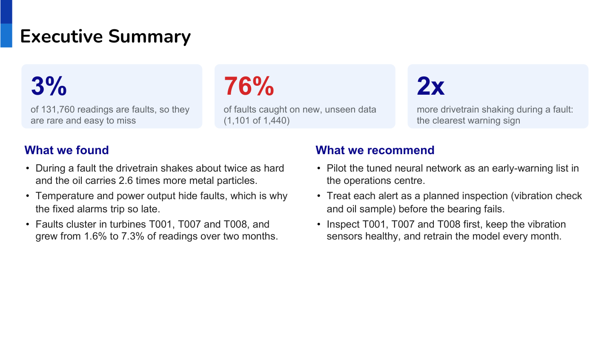

## Business Problem Overview and Solution Approach

The company in this project, Aeolus Renewables, is made up. It runs 1,150 wind turbines and only earns money while they turn. A failed gearbox or main bearing keeps a turbine offline for 7 to 21 days and needs a crane, and the fixed alarms only go off when the fault is almost final. The goal is a model that reads one 10-minute sensor reading and says "fault" or "normal", tuned to catch as many real faults as possible.

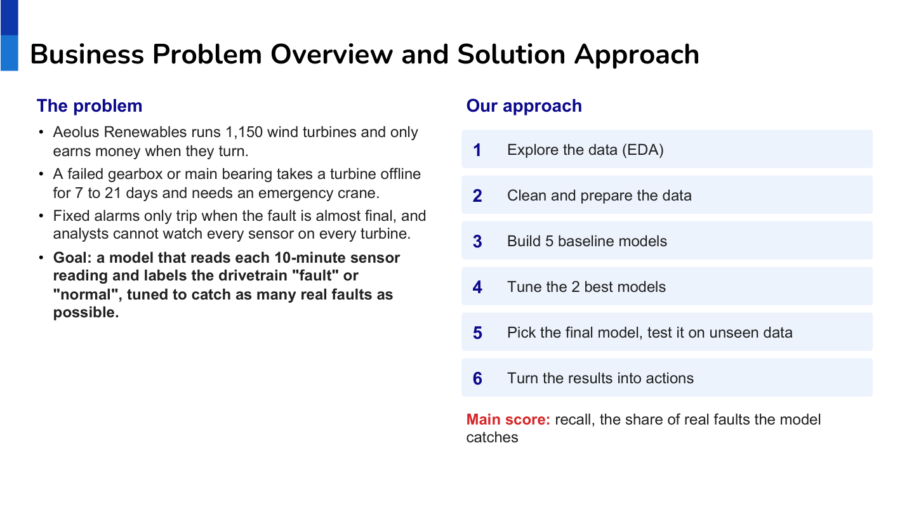

I judged the models on recall, the share of real faults they catch. A missed fault costs far more than an extra inspection. Accuracy would fool us here, because a model that always says "normal" is 97% accurate and catches nothing.

## EDA Results

The exploration is split by how many columns each chart looks at, and every chart is tagged on the slide.

**Univariate analysis** looks at one column at a time. Faults are rare, vibration has a small second bump where the faults sit, and gearbox oil temperature has two humps because it follows how hard the turbine works.

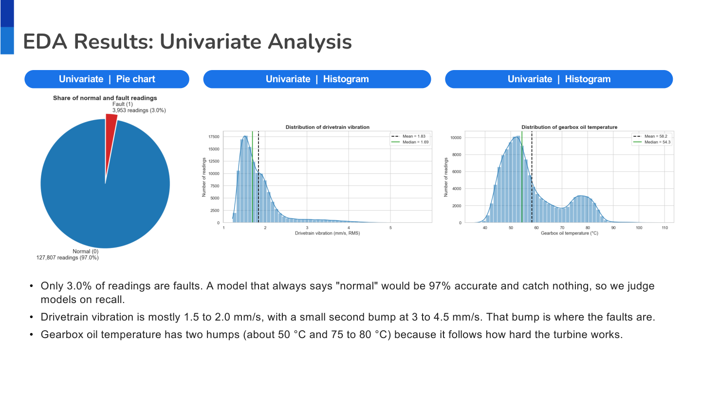

**Bivariate analysis** compares each column with failure. T001, T007 and T008 fault about twice as often as the average turbine. Faults have a median vibration of 3.63 mm/s against 1.68 for normal readings, and about 2.6 times more metal particles in the oil (165 against 64).

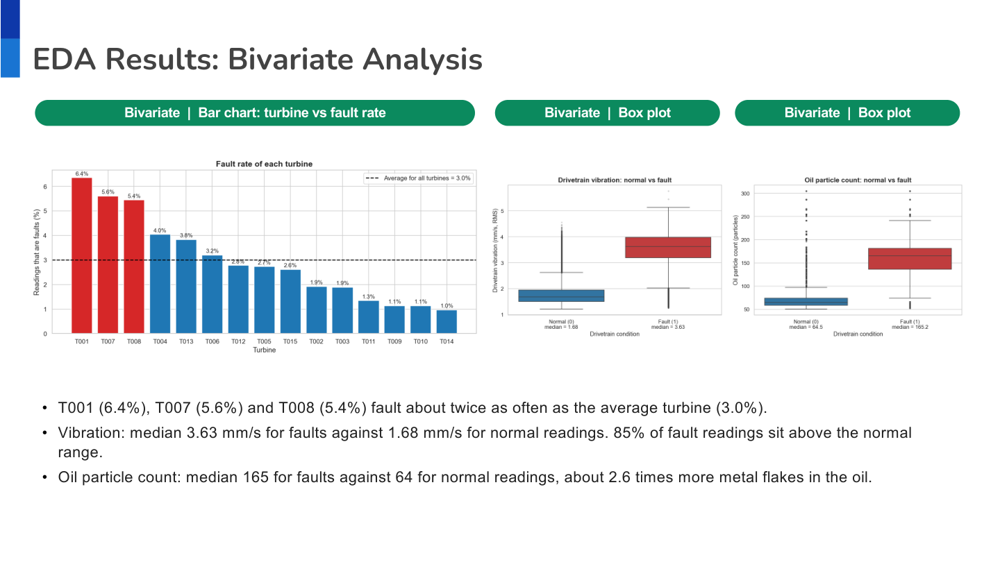

**Multivariate analysis** looks at many columns together. 75% of fault readings have both high vibration and many oil particles, against only 4% of normal readings. The temperatures all move together and barely move with failure.

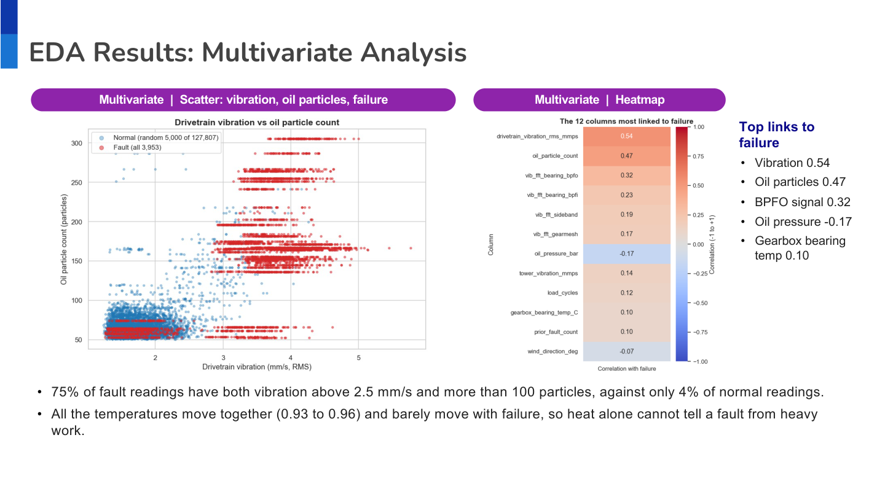

## Data Preprocessing

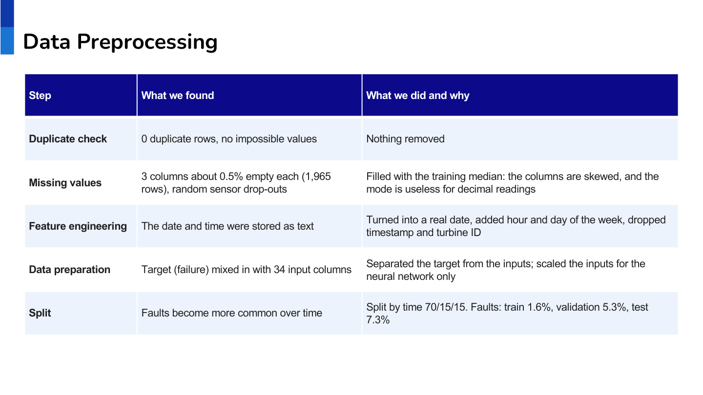

There were no duplicates. Three columns were missing about 0.5% of their values each, so I filled them with the training median. The text date became a real date, plus the hour and the day of the week. The data is split by time, 70% train, 15% validation and 15% test, and not at random. One fault lasts many readings in a row, so a random split would let the model see the answer.

## Model Performance Summary and Final Model Selection

I tuned the two best baselines, and both improved on validation recall.

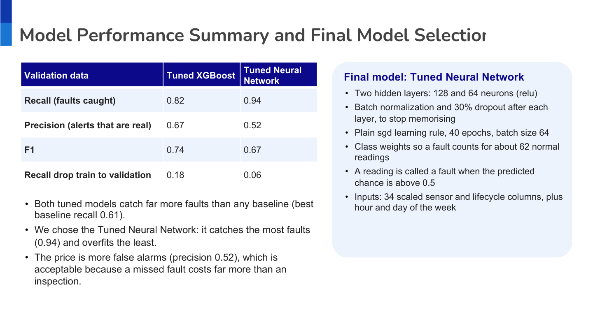

The final model is the tuned neural network. On the test data it caught 1,101 of the 1,440 faults (recall 0.76) and raised 854 false alarms (precision 0.56). Recall is lower than on the validation data (0.94) because the test period is the newest one and has the most faults. The model relies mostly on drivetrain vibration: shuffling that one column drops recall by 0.66.

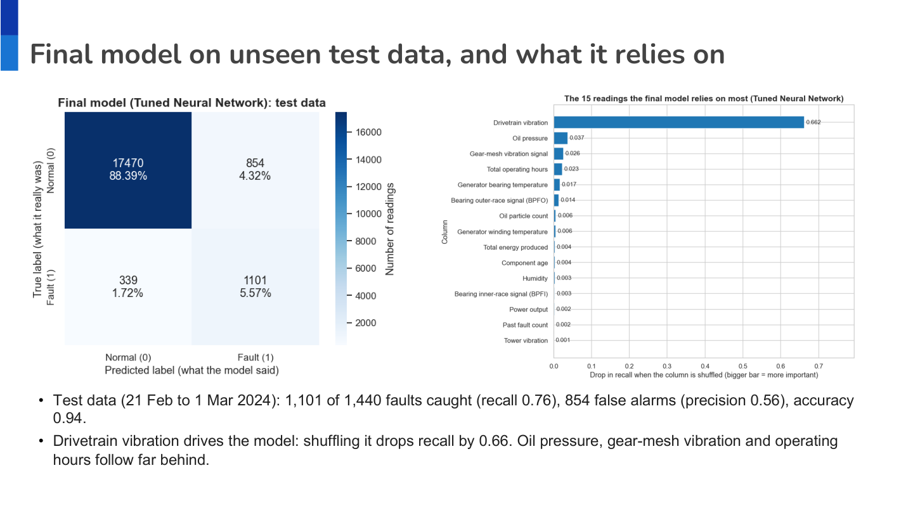

## Actionable Insights and Recommendations

Use the model as an early-warning list, turn each alert into a planned inspection, count one alert per turbine per day, inspect T001, T007 and T008 first, look after the vibration sensors, and retrain every month.

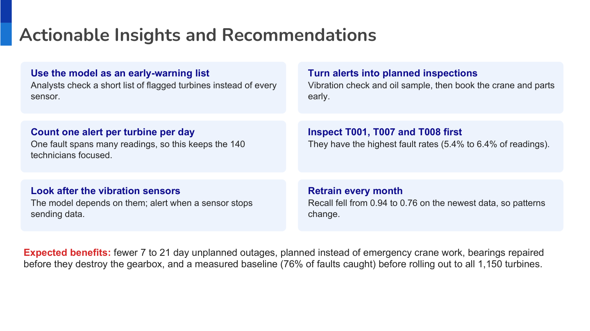

## Appendix

**Data Background and Contents.** The data has 131,760 rows and 35 columns. Each row is one 10-minute reading from one of 15 turbines, from 1 January to 1 March 2024.

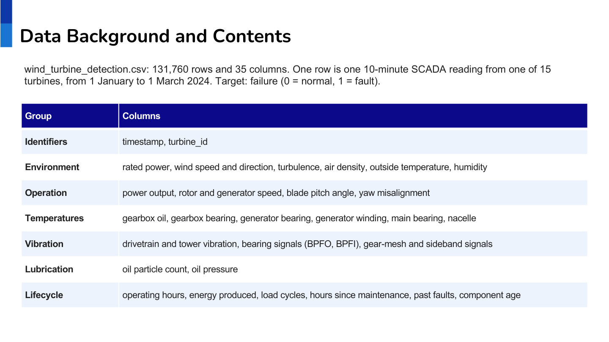

**Additional EDA.**

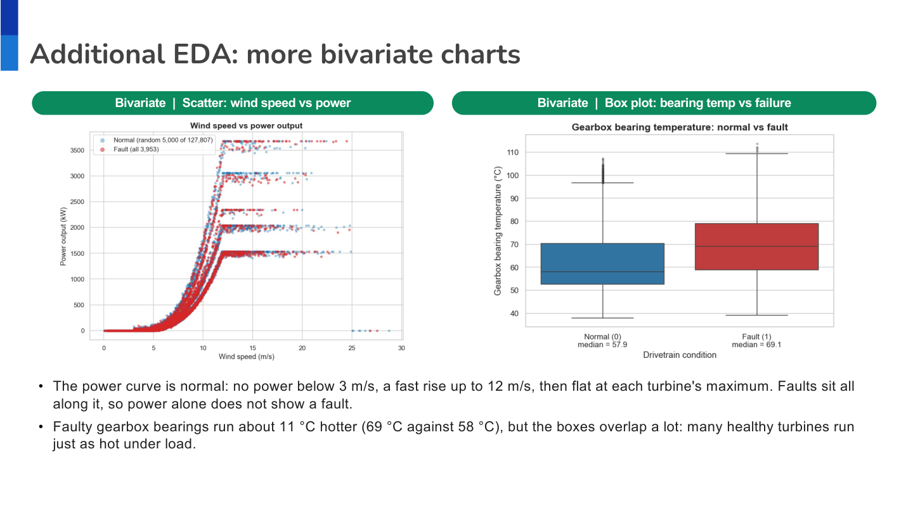

**Model Building - Baseline.** Five models were built on the imbalanced training data: Decision Tree, Random Forest, Gradient Boosting, XGBoost and a small neural network.

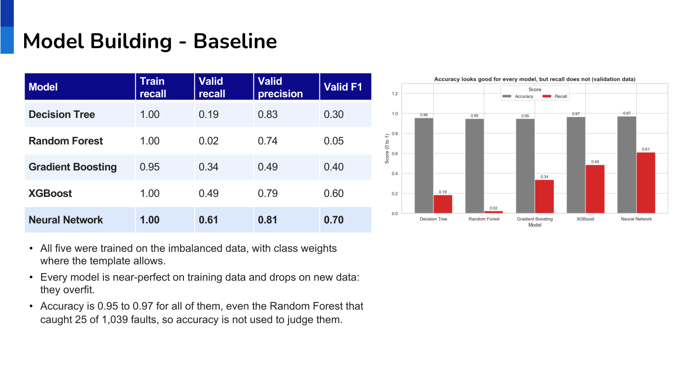

**Model Improvement - Hyperparameter Tuning.**

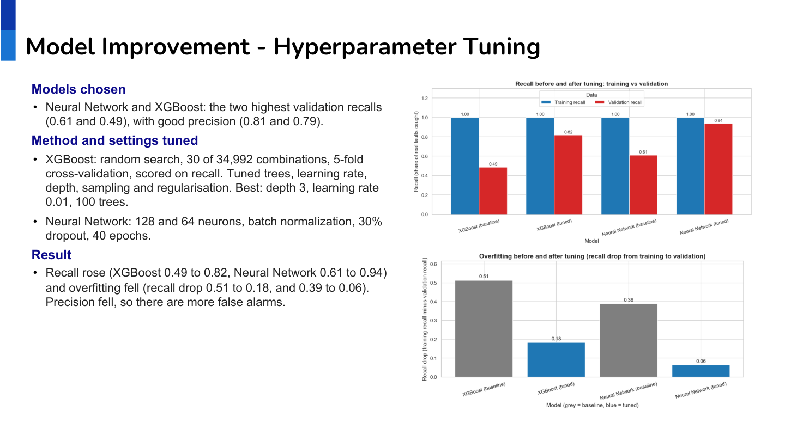

## What is in the repo

```
.
├── notebooks/
│   ├── low_code/
│   │   └── AIML_Project_1_Low_Code_Notebook.ipynb
│   └── full_code/
│       ├── AIML_Project_1_Full_Code_Notebook.ipynb
│       └── AIML_Project_1_Full_Code_Notebook.html
├── presentation/
│   ├── Wind_Turbine_Failure_Detection_Presentation.pdf
│   └── Wind_Turbine_Failure_Detection_Presentation.pptx
├── images/slides/        the slide images used in this README
├── data/
│   └── README.md
└── requirements.txt
```

The low-code notebook is the main one, and the presentation is the business version of it. It has a short explanation before every step and a "used for, what it shows, hence" note after every chart and table.

The full-code notebook is an earlier, separate version of the same project, with an HTML export. It ends with a different final model: tuned XGBoost with the decision cut-off lowered to 0.375, which I chose on the validation data. On the test data it caught 92% of the faults (precision 0.47). The two versions made different choices, so their test scores are not a like-for-like comparison.

## The data

The data file, `wind_turbine_detection.csv`, came with the course, so it is not in this repo. Put it in the same folder as the notebook you want to run. Both notebooks read it from there.

## Running it

I ran everything on Python 3.12.

```bash
pip install -r requirements.txt
jupyter lab
```

Open a notebook, put `wind_turbine_detection.csv` next to it, and run the cells from the top. The first cell of each notebook also installs the pinned library versions, so you can skip the `pip install` above if you prefer. On a Mac, XGBoost may ask for the OpenMP library: `brew install libomp`.

If you run a later section on its own, you will get a `NameError` for `X_train`. Those names are made in the Data Preprocessing section, so run everything above first (Run > Run All Above Selected Cell).

## Limits

The data covers only two months and 15 turbines, so I would test on a longer period and more turbine models before trusting it across a whole fleet. The project brief and the slide template are course materials, so they are not included here.
